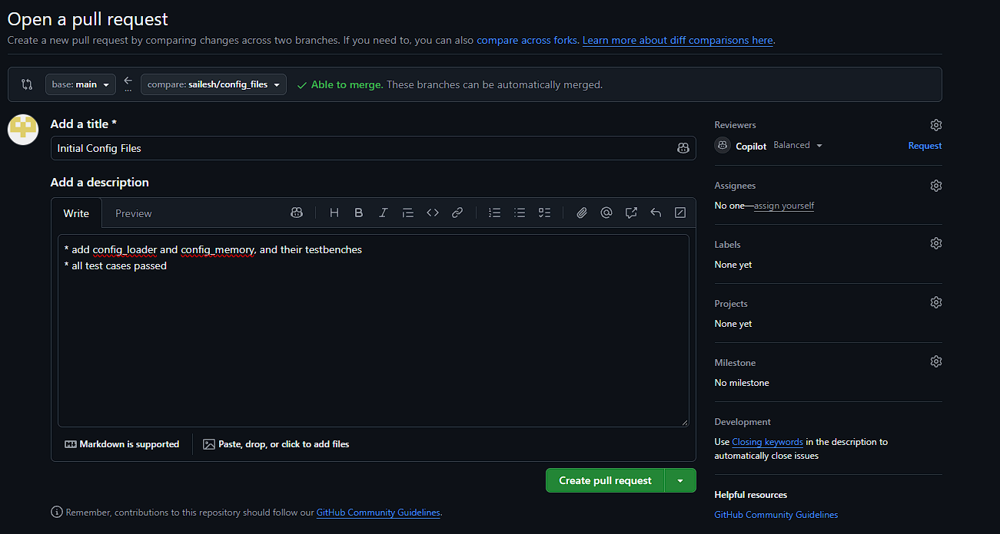
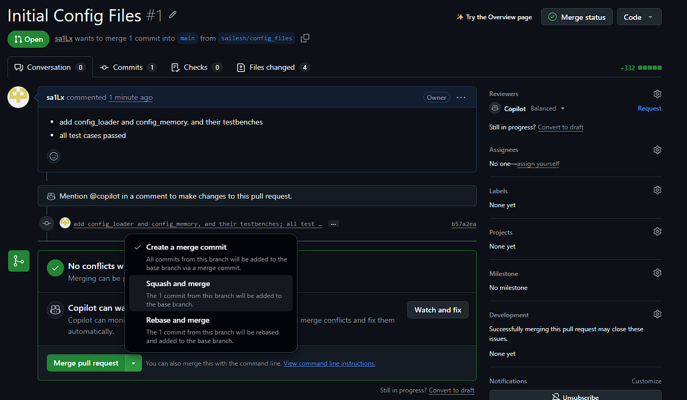
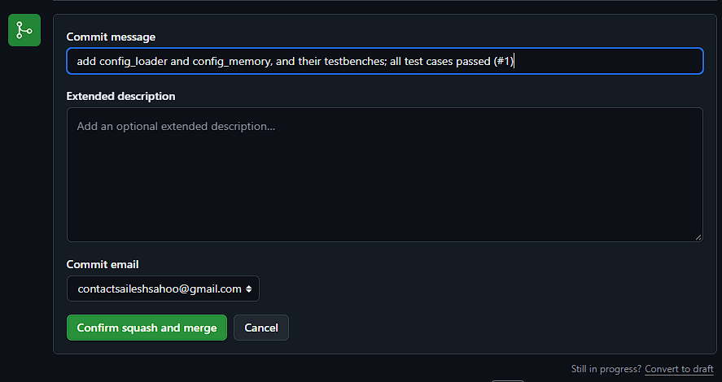
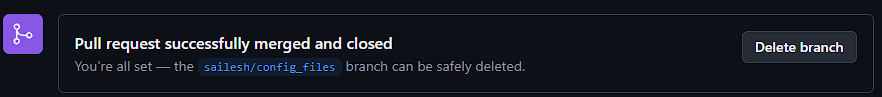

# How we work: branches and pull requests

**Never commit directly to `main`.** Every change goes: **branch → pull request (PR) → squash and merge**.
No review is needed: you open the PR and merge it yourself. This keeps `main` clean, with one commit per piece of work.

## Every time you start new work

```
git checkout main
git pull
git checkout -b <your-name>/<short-task>
```

Branch name example: `sailesh/config-loader`. One branch = one task.

## While working

```
git add <files>
git commit -m "Short description of the change"
```

Commit as often as you like; these get squashed into one commit at merge.

## When the task is done

**1. Catch up with `main`** (in case others merged meanwhile):

```
git fetch origin
git rebase origin/main
```

If there's a conflict: fix the marked lines in the listed files, then `git add <files>` and `git rebase --continue`. To undo the rebase: `git rebase --abort`.

**2. Push your branch:**

```
git push -u origin <your-name>/<short-task>
```

(If you pushed before and then rebased, use `git push --force-with-lease` instead.)

**3. Open the PR on GitHub:**

- Click **Compare & pull request** on the yellow banner.
- Base: `main`, compare: your branch.
- Write a title and one or two lines on what changed and how you tested it.
- Click **Create pull request**.


*Opening a PR: base is `main`, compare is your branch. Add a title and a short description, then click **Create pull request**.*

**4. Merge it:**

- Check the **Files changed** tab: only the files you meant to change.
- Click the arrow next to the merge button → **Squash and merge** → **Confirm**.
- Click **Delete branch**.


*Click the arrow next to **Merge pull request** and choose **Squash and merge**.*


*Check the squashed commit message (GitHub appends the PR number), then click **Confirm squash and merge**.*


*Once merged, click **Delete branch** to remove your branch from GitHub.*

**5. Clean up locally:**

```
git checkout main
git pull
git branch -D <your-name>/<short-task>
```

## Rules

- Always **Squash and merge**, never a plain merge.
- Use `git rebase origin/main`, never `git merge main`, to update your branch.
- Delete your branch after merging.
- Keep PRs small: one task each.
- Don't commit generated files (`.gitignore` handles most of them).

## Quick reference

```
git checkout main && git pull                 # start fresh
git checkout -b name/task                     # new branch
git add <files> && git commit -m "message"    # save work
git fetch origin && git rebase origin/main    # catch up with main
git push -u origin name/task                  # push (first time)
git push --force-with-lease                   # push after a rebase
# GitHub: Compare & pull request → Squash and merge → Delete branch
git checkout main && git pull && git branch -D name/task
```

## Repo owner: one-time settings

**Settings → General → Pull Requests:** untick *Allow merge commits* and *Allow rebase merging*, keep *Allow squash merging*, tick *Automatically delete head branches*.

**Settings → Branches → Add rule** for `main`: tick *Require a pull request before merging*, set required approvals to **0**.
